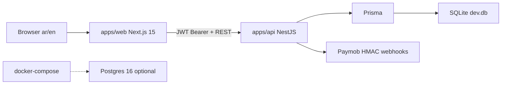

# Gamers Matrix — Implementation Plan

> **Status:** Phase 0–6 complete (through account/support polish + rate limits + mail adapter). Approved architecture defaults locked below.  
> **Design contract:** [`DESIGN_SYSTEM.md`](./DESIGN_SYSTEM.md) — follow for every UI phase.  
> **Phase prompts:** [`IMPLEMENTATION_PROMPTS.md`](./IMPLEMENTATION_PROMPTS.md) — run one phase at a time.  
> **Do not** treat this file as permission to implement multiple phases at once.

---

## Constraints

1. Inspect before changing; preserve the existing stack, package manager, and working integrations.
2. Execute only the phase the user explicitly requests.
3. No fake metrics, invented integrations, hardcoded secrets, or misleading success states.
4. Arabic is the default UI language (`lang` / `dir`, logical CSS, mixed LTR isolation).
5. Payment proof is server-side (webhooks), never client redirect alone. Digital keys only after trusted payment + assignment.

---

## 1. Existing architecture (inspected)

| Area | Finding |
|------|---------|
| **Monorepo** | npm workspaces + Turbo (`apps/*`, `packages/*`). Package manager: **npm** (`package-lock.json`, `packageManager: npm@12.0.2`). |
| **Web** | Next.js **15.5** App Router, React 19, Tailwind v4, `next-intl` (default `ar`, `localePrefix: always`), Lucide. Entry: `apps/web/src/app`, middleware `apps/web/src/middleware.ts`. |
| **API** | NestJS 11, Prisma 6, JWT/Passport, class-validator. Entry: `apps/api/src/main.ts`. Port 3001. |
| **Shared packages** | `packages/` is empty (`.gitkeep` only). |
| **DB** | SQLite via Prisma (`apps/api/prisma/schema.prisma`); optional Postgres in `docker-compose.yml`. |
| **Auth** | Custom JWT in `localStorage` (`gm_token`); roles `USER` / `ADMIN`. No NextAuth/Clerk. |
| **Payments** | Custom Paymob intention + HMAC webhook (`apps/api/src/payments/`); empty keys → mock fulfillment (README). |
| **Design tokens in code** | Blue/slate palette in `apps/web/src/app/globals.css` (`--gm-accent: #2563eb`, Tajawal). **Diverges from design-system violet/plum contract.** |
| **UI kit** | Feature components under `apps/web/src/components/`; only light primitive: `ui/Reveal.tsx`. No shadcn. |
| **Tests** | API Jest configured; unit specs largely absent; e2e looks like Nest scaffold leftover. Web: no test script. Root: no `typecheck` / `test`. |
| **Commands** | Root: `dev`, `build`, `lint`, `db:*`. Web: `dev` / `build` / `start` / `lint`. API: same + `test*` + Prisma scripts. |

### Current storefront routes (`/[locale]/…`)

`/`, `/products`, `/products/[slug]`, `/shop`, `/gift-cards`, `/top-ups`, `/cart`, `/checkout`, `/checkout/success`, `/wishlist`, `/account`, `/login`, `/register`, `/support`, `/admin`, `/admin/products`, `/admin/categories`, `/admin/keys`, `/admin/orders`.

### Missing vs design-system IA

`/categories/[slug]`, `/offers`, `/search`, `/orders/[orderNumber]`, `/help`, `/contact`, `/terms`, `/privacy`, `/refund-policy`, plus Content Studio / publishing / media / campaigns / audit / settings admin areas.

### Current data entities

User, Category, Product (`priceEGP`, flags, `soldCount`, `active` boolean—not a publication state machine), ProductKey, Cart/CartItem, Order/OrderItem, Payment, WishlistItem, Review.

**Absent today:** variants, region, coupons/campaigns, media library, content pages, publication revisions, audit log, fine-grained permissions, fulfillment status beyond key assignment.

---

## 2. What already works and must be preserved

- Monorepo layout, npm, Turbo task graph.
- Next App Router + `next-intl` Arabic-first routing.
- Nest API module boundaries (auth, products, cart, orders, payments, wishlist, reviews, admin).
- Prisma schema + init migration + seed + demo accounts (do not wipe DB without explicit approval).
- Paymob adapter path and HMAC verification entry point; mock mode when credentials empty.
- Working commerce skeleton: catalog pages, cart/checkout, account keys, basic admin CRUD for products/categories/keys/orders.
- Lucide as the icon library (matches design contract preference).

**Do not:** replace Nest with Next Route Handlers; swap npm for pnpm/yarn; rewrite the whole storefront in one phase; delete working user code for a clean scaffold.

---

## 3. Target architecture (locked)

Prefer the existing stack. No new top-level apps.

| Layer | Decision |
|-------|----------|
| **Web** | Keep `@gamersmatrix/web`. Evolve tokens/primitives in-place; add reusable UI under `components/ui`. Do not force a full shadcn install unless a later phase truly needs it. |
| **API** | Keep `@gamersmatrix/api` as the single backend. Public vs admin separation stays in Nest controllers/services. |
| **DB** | Keep SQLite for local/dev; Postgres remains the documented production path. Schema changes via Prisma migrations only. |
| **Currency** | Keep Paymob; introduce configurable store currency/settings. Phase 3: migrate `priceEGP` / `totalEGP` toward amount + currency code (with safe migration). |
| **Payments** | Keep Paymob; wrap behind a small provider interface (mock vs live). Phase 4: strengthen webhook idempotency. Never treat client return URL as payment proof. |
| **Auth** | Keep JWT for Phases 1–5; httpOnly cookie / CSRF hardening planned for Phase 6–7. |
| **Queue** | No Redis/Bull in early phases. Phase 5 scheduled publish: Nest in-process scheduler polling due items. Redis only if multi-instance locking is required later. |
| **Shared package** | Defer `packages/shared` until Phase 3+ duplication warrants it. |

**Design alignment:** Phase 1 replaces blue/slate tokens and Tajawal-as-primary with design-system violet/plum tokens and Arabic/Latin font pairing (IBM Plex Sans Arabic or Cairo + Space Grotesk), preserving layout structure where possible. The left desktop navigation rail is preserved per design contract while content remains RTL-correct in Arabic.

---

## 4. Approved decisions (D1–D8)

Plan approval locks the recommended defaults. Change only with an explicit override.

| ID | Topic | Locked decision |
|----|--------|-----------------|
| **D1** | Visual rebrand | Phase 1 aligns tokens/fonts to `DESIGN_SYSTEM.md` (violet), replacing current blue/Tajawal primary look. |
| **D2** | Database | Stay on SQLite for local; Postgres remains optional documented path. Do not force PostgreSQL provider in Phase 3 unless re-approved. |
| **D3** | Payments / currency | Keep Paymob; migrate hardcoded `*EGP` fields to amount + currency; default currency from settings/env. |
| **D4** | Reviews / soldCount | Hide or gate public reviews/sold metrics until verified; no fabricated social proof. |
| **D5** | Auth storage | Keep bearer JWT short-term; plan httpOnly cookie migration in Phase 6–7. |
| **D6** | Scheduler infra | Nest in-process schedule first; no Redis unless multi-instance needs appear. |
| **D7** | Legal pages | Structured placeholders + settings fields; no invented company registration claims. |
| **D8** | `packages/shared` | Defer until Phase 3+ duplication warrants it. |

---

## 5. Phase-by-phase plan

### Phase 1 — Tokens, primitives, shells

- **Change:** `apps/web/src/app/globals.css`, fonts in root/locale layouts, new `components/ui/*`, storefront shell (header, left desktop rail → mobile drawer), admin shell skeleton.
- **Preserve:** route files, API calls, existing page data wiring (may look temporarily mismatched until Phase 2).
- **Checks:** `npm run lint` / `npm run build:web` (and API lint if touched).
- **Deps:** fonts via `next/font`; Lucide already present. Avoid new UI frameworks.
- **Out of scope:** full catalog redesign, new API entities, payments.

### Phase 2 — Storefront UX (fixtures or live API)

- **Routes to add/align:** categories, offers, search, help/contact/legal; refine home/catalog/PDP; central price formatter; isolate fixtures behind a repository interface if API fields lag.
- **Components:** ProductCard states, filters from real fields only, empty/loading/error.
- **Integrity:** no fake reviews/stock; treat `soldCount` per D4; branded placeholders if art missing.
- **Deps:** none required beyond existing.

### Phase 3 — Data model, API contracts, authz

- **Entities to add/refine:** ProductVariant, region, MediaAsset, Campaign/Coupon, PublicationState + Revision, ContentPage, AuditLog, StoreSettings; expand Role/Permission beyond binary ADMIN if needed; OrderNumber; Fulfillment status; currency fields.
- **Security:** server validation, slug uniqueness, public DTO redaction (no keys/raw secrets), transactional transitions.
- **Tests:** Jest unit tests for validation, authz, slug, publication transitions.
- **Deps:** Prisma migrations only; schedule package deferred to Phase 5.

### Phase 4 — Cart, checkout, payments, fulfillment

- Server totals, coupons, order lifecycle, webhook signature + **idempotent** delivery, key disclosure only post-paid, clear mock vs live.
- **Tests:** totals, coupon edges, unauthorized order access, webhook replay, duplicate fulfillment prevention.
- **Env:** Paymob vars already named; document only—never paste secrets into chat.

### Phase 5 — Admin + Content Studio

- Dense admin: overview (real metrics only), products, categories, media, campaigns, orders, customers, roles, settings, audit.
- Publishing state machine: `draft → in_review → scheduled → published → archived`; autosave UI; preview; slug checks; Nest scheduler for due publishes.
- **Deps:** `@nestjs/schedule` (or equivalent) only if not present; safe file upload validation.

### Phase 6 — Account, support, ops polish

- Order timeline, authorized fulfillment view, support entry, email adapter boundary, owner-configurable legal/contact fields.
- Auth hardening per D5 if still approved.

### Phase 7 — QA / release readiness

- Lint, build, API tests, responsive/RTL/a11y/security pass; web `.env.example`; README accuracy; go/no-go assessment.

---

## 6. Environment variables / providers (names and descriptions only)

### API (existing + planned)

| Name | Description |
|------|-------------|
| `DATABASE_URL` | Prisma connection string |
| `JWT_SECRET` | Auth token signing secret |
| `JWT_EXPIRES_IN` | JWT lifetime |
| `PORT` | API listen port |
| `FRONTEND_URL` | Storefront origin for CORS / payment return redirects |
| `PAYMOB_API_KEY` | Paymob API key |
| `PAYMOB_SECRET_KEY` | Paymob secret key |
| `PAYMOB_PUBLIC_KEY` | Paymob public key |
| `PAYMOB_INTEGRATION_ID` | Paymob integration id |
| `PAYMOB_HMAC_SECRET` | Paymob webhook HMAC secret |
| `PAYMOB_BASE_URL` | Paymob API base URL |
| `STORE_CURRENCY` | *(planned)* Default store currency code |
| `STORE_DEFAULT_LOCALE` | *(planned)* Default locale |
| `STORE_TIMEZONE` | *(planned)* Store timezone for schedules |
| `SMTP_*` / mail provider vars | *(planned, optional)* Transactional email adapter |
| `UPLOAD_MAX_BYTES` | *(planned, optional)* Max upload size |
| `MEDIA_STORAGE_PATH` / object-storage keys | *(planned, optional)* Media storage |

### Web

| Name | Description |
|------|-------------|
| `NEXT_PUBLIC_API_URL` | API base URL |
| `NEXT_PUBLIC_WHATSAPP` | Support WhatsApp link |
| `NEXT_PUBLIC_STORE_NAME` | *(planned)* Display store name |
| `NEXT_PUBLIC_DEFAULT_CURRENCY` | *(planned)* Display currency hint; authoritative totals remain server-side |

Configure secrets via local `.env` / host secret management. Do not paste secret values into prompts.

---

## 7. Risks and known gaps

- Webhook path exists but idempotency/replay safety needs hardening (Phase 4).
- `ProductKey.code` stored plaintext in SQLite — design expects encrypted-at-rest or provider-managed secrets (Phase 3–4).
- Admin is binary `ADMIN` only — Content Studio permissions need expansion (Phase 3/5).
- Nested `apps/api/package-lock.json` can confuse installs — avoid touching unless install issues appear.
- Design-system left desktop rail vs Arabic RTL: contract preserves left rail with RTL content — implement as specified.
- No web `.env.example` yet (add by Phase 7 at latest; earlier if web env surface grows).
- Root has no dedicated `typecheck` / `test` scripts; API e2e is largely a Nest scaffold leftover.

---

## 8. Phase 0 completion record

| Item | Result |
|------|--------|
| **Implemented** | Repository audit documented; architecture and phase roadmap locked; D1–D8 approved defaults recorded. |
| **Files changed** | `docs/IMPLEMENTATION_PLAN.md` (this file only). |
| **Commands run** | Read-only inspection during Phase 0 audit. No lint/typecheck/build pass/fail gate required for this documentation phase. |
| **Known gaps / credentials** | Paymob and production DB credentials remain operator-configured; not required for Phase 1. |
| **Exact next phase** | **Phase 1 — Brand foundation, tokens, and responsive app shell** (see `IMPLEMENTATION_PROMPTS.md`). |

To continue, send: **Run Phase 1 only** (with the Master Prompt constraints still in force).
